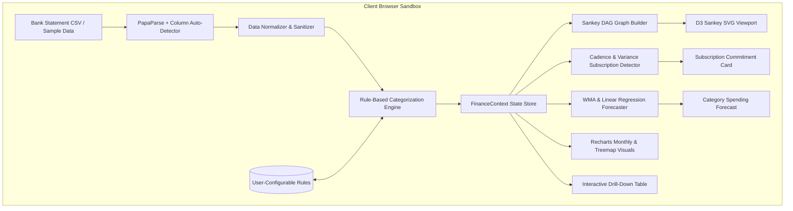
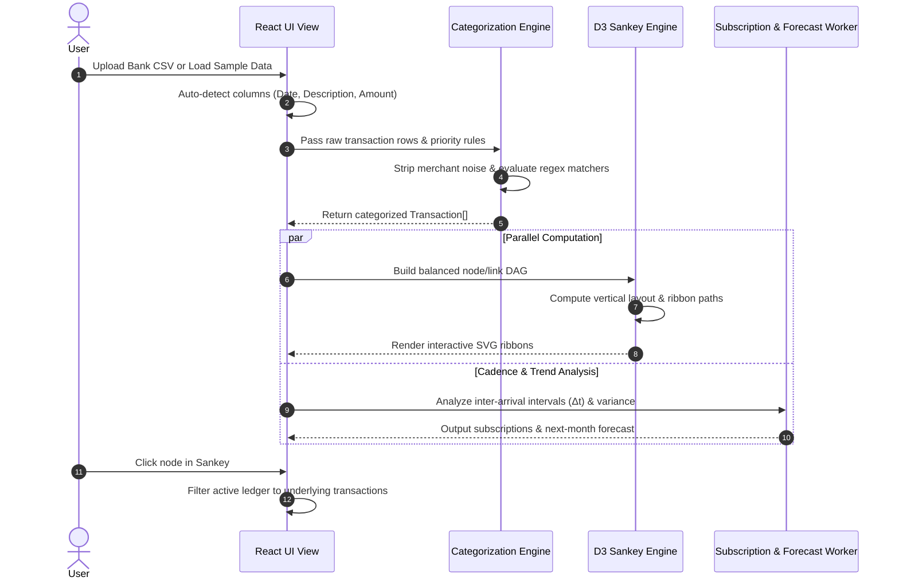

# Personal Finance Sankey Flow

> **Privacy-First Personal Finance & Cash Flow Visualizer** powered by client-side CSV parsing, rule-based keyword matching, multi-tier Sankey graph balancing, subscription cadence detection, and statistical spending forecasting.


---

## 1. Executive Overview

Most online personal finance dashboards require granting access to third-party aggregators (e.g. Plaid, MX) or uploading raw unencrypted bank statements to remote servers. **Personal Finance Sankey Flow** was engineered with a strict **Zero-Knowledge, Client-Side-Only Security Model**:

- **100% In-Browser Execution**: All CSV parsing, normalization, keyword-based heuristics, and graph flow calculations execute directly in the browser's JavaScript V8 runtime.
- **Zero Telemetry / Zero Trackers**: No analytics tokens, no telemetry beacons, and no network traffic are dispatched during statement parsing.
- **Multi-Tier Flow Balancing**: Transforms unstructured debit/credit rows into a strict Directed Acyclic Graph (DAG) using `d3-sankey`, balancing income sources through central hubs down to granular subcategories, while reconciling retained cash surplus or budget deficits.
- **Statistical Subscriptions & Cadence Detection**: Groups recurring transactions by cleaned merchant fingerprints and calculates interval coefficient of variation ($CV_{\Delta t}$) and amount coefficient of variation ($CV_A$) to isolate hidden recurring obligations.
- **Trend-Aware Forecasting**: Projects next-month category expenditures using a blended model combining exponential/weighted moving averages (WMA) and linear regression slopes with 80% confidence intervals.

---

## 2. Architecture & Component Hierarchy



### Flow Execution Sequence



---

## 3. Algorithmic Breakdown

### 3.1 Heuristic & Regex Categorization Engine

Incoming bank transaction descriptions are notorious for punctuation noise, POS terminal numbers, store IDs, and trailing location tags:

$$\text{Raw: } \texttt{"CHECKCARD 0514 WHOLE FOODS SOHO #1042 NEW YORK NY"}$$

1. **Sanitization Phase (`cleanMerchantName`)**:
   - Strips payment prefixes: `POS DEBIT`, `CHECKCARD`, `ACH WITHDRAWAL`, `BILL PAY`.
   - Strips non-informative identifiers: `#[0-9]+`, `STORE \d+`, `\*[A-Z0-9_\-\.]+`.
   - Strips trailing two-letter state abbreviations: `\b[A-Z\s]+(CA|NY|WA|TX|IL|...)\b`.
2. **Rule Evaluation**:
   Each rule $R_i$ contains:
   - Pattern string $P_i$ (either regex or substring)
   - Target category $C_i$ and subcategory $S_i$
   - Priority weight $w_i \in [1, 200]$
   - Boolean flag $E_i$ (enabled state)
   
   Rules are evaluated in descending order of priority:
   $$\text{match}(t) = \operatorname{argmax}_{R_i \mid E_i = \text{true} \land \text{eval}(P_i, \text{desc}(t))} (w_i)$$

Users can modify, extend, and test regex patterns in the built-in **Rule Matcher Sandbox**.

---

### 3.2 Sankey DAG Formulation & Balance Invariants

A Sankey diagram requires strict conservation of flow across its intermediate nodes. In personal finance, this is complicated by unequal inflows and outflows.

#### Graph Node Hierarchy:
- **Layer 0 (Left)**: Specific Income Sources ($I_1, I_2, \dots, I_k$)
- **Layer 1 (Center-Left)**: Central Hub: $\text{Total Income}$
- **Layer 2 (Center-Right)**: Main Spending Categories ($C_1, C_2, \dots, C_m$) + Savings Hub
- **Layer 3 (Right)**: Granular Subcategories ($S_{1,1}, \dots, S_{m,p}$)

#### Flow Balancing Equations:

$$\text{Total Inflow } T_{\text{in}} = \sum_{j=1}^k I_j$$

$$\text{Total Outflow } T_{\text{out}} = \sum_{m} \sum_{p} S_{m,p}$$

1. **Case 1: Positive Cash Flow (Surplus / Net Savings)**:
   When $T_{\text{in}} > T_{\text{out}}$:
   $$\Delta_{\text{surplus}} = T_{\text{in}} - T_{\text{out}}$$
   An auxiliary node $\text{Node}_{\text{Net Savings (Surplus)}}$ is injected at Layer 2 with link:
   $$\text{Link}(\text{Total Income} \to \text{Net Savings}, \text{value} = \Delta_{\text{surplus}})$$
   *Result: Total layer outflow equals total inflow with zero truncation.*

2. **Case 2: Deficit Spending (Expenses Exceed Inflows)**:
   When $T_{\text{out}} > T_{\text{in}}$:
   $$\Delta_{\text{deficit}} = T_{\text{out}} - T_{\text{in}}$$
   An auxiliary source node $\text{Node}_{\text{Budget Deficit / Debt}}$ is injected at Layer 0 with link:
   $$\text{Link}(\text{Budget Deficit} \to \text{Total Income}, \text{value} = \Delta_{\text{deficit}})$$

---

### 3.3 Recurring Subscription Cadence & Variance Detection

To identify hidden commitments (e.g. Netflix, Spotify, gym dues, internet, cloud services), the detector performs chronological interval clustering on grouped merchant transactions:

For a merchant with sequential transaction dates $t_0 < t_1 < \dots < t_N$:
1. Calculate inter-arrival intervals in days:
   $$\Delta t_i = t_i - t_{i-1}, \quad i \in [1, N]$$
2. Compute the mean interval and standard deviation:
   $$\mu_{\Delta t} = \frac{1}{N} \sum_{i=1}^N \Delta t_i, \qquad \sigma_{\Delta t} = \sqrt{\frac{1}{N} \sum_{i=1}^N (\Delta t_i - \mu_{\Delta t})^2}$$
3. Compute the **Coefficient of Variation** for cadence:
   $$CV_{\Delta t} = \frac{\sigma_{\Delta t}}{\mu_{\Delta t}}$$
4. Compute the **Coefficient of Variation** for charge amounts:
   $$CV_{A} = \frac{\sigma_A}{\mu_A}$$
5. **Cadence Classification**:
   - $\mu_{\Delta t} \in [5, 9] \implies \text{Weekly}$ ($\text{Cadence} = 7$)
   - $\mu_{\Delta t} \in [12, 16] \implies \text{Bi-Weekly}$ ($\text{Cadence} = 14$)
   - $\mu_{\Delta t} \in [25, 35] \implies \text{Monthly}$ ($\text{Cadence} = 30.4$)
   - $\mu_{\Delta t} \in [80, 100] \implies \text{Quarterly}$ ($\text{Cadence} = 91.25$)
   - $\mu_{\Delta t} \in [340, 380] \implies \text{Annual}$ ($\text{Cadence} = 365$)
6. **Variance Score Rating**:
   - **Low**: $CV_A \le 0.15 \land CV_{\Delta t} \le 0.20$
   - **Medium**: $0.15 < CV_A \le 0.30 \lor 0.20 < CV_{\Delta t} \le 0.35$
   - **High**: $CV_A > 0.30 \lor CV_{\Delta t} > 0.35$

---

### 3.4 Next-Month Spending Forecast Model

The system forecasts next-month expenditure per category using a weighted blend of **Weighted Moving Average (WMA)** and **Ordinary Least Squares (OLS) Linear Trend**:

1. **Weighted Moving Average ($WMA$)**:
   Given monthly amounts $y_1, y_2, \dots, y_n$ (chronological order):
   $$WMA = \frac{\sum_{i=1}^n i \cdot y_i}{\sum_{i=1}^n i}$$
2. **Linear Regression Trend Projection ($Trend$)**:
   $$\text{Slope } \beta = \frac{\sum_{i=1}^n (i - \bar{x})(y_i - \bar{y})}{\sum_{i=1}^n (i - \bar{x})^2}, \qquad \alpha = \bar{y} - \beta \bar{x}$$
   $$Trend_{n+1} = \max(0, \alpha + \beta (n+1))$$
3. **Blended Projection**:
   $$\hat{y}_{n+1} = 0.65 \cdot WMA + 0.35 \cdot Trend_{n+1}$$
4. **80% Confidence Interval**:
   $$CI_{80\%} = [\max(0, \hat{y}_{n+1} - 0.8\sigma), \; \hat{y}_{n+1} + 0.8\sigma]$$

---

## 4. Privacy & Data Security Model

| Security Dimension | Implementation in Personal Finance Sankey Flow |
| :--- | :--- |
| **Data Storage** | Strictly in-memory during active tab session; persistent only in browser `localStorage` if opted-in. |
| **Network Outflows** | **0 bytes**. No outbound analytical pings, tracking cookies, or Sentry reports. |
| **Offline Capability** | Fully functional in offline mode (`navigator.onLine === false`) or air-gapped environments. |
| **Data Purge** | One-click memory purge resets state and clears `localStorage` immediately. |

---

## 5. Preloaded Sample Validation Dataset

The application includes a realistic 6-month test dataset (**May 2026 – October 2026**) with ~280 transactions verifying:
- **Income Consistency**: Bi-weekly payroll ($4,250 each), variable consulting ($1,200 – $1,800), and monthly investment dividends.
- **Fixed Commitments**: Rent ($2,450), Lemonade Insurance ($18.50), Verizon Fios ($79.99), ConEd Electricity ($95–$140).
- **Subscription Detection Controls**: Netflix ($22.99), Spotify Family ($16.99), OpenAI ChatGPT ($20.00), GitHub Copilot ($10.00), Equinox Fitness ($235.00), iCloud Storage ($2.99).
- **Variable Spend**: Weekly groceries at Trader Joe's & Whole Foods, coffee runs, metro transit rides, dining, and Amazon retail purchases.
- **Savings Transfers**: Regular monthly contributions to Vanguard Roth IRA ($583.33) and Marcus HYSA ($1,850.00).

---

## 6. Getting Started

### Prerequisites
- Node.js `v18.0.0` or higher
- npm `v9.0.0` or higher

### Installation & Run

```bash
# Clone the repository
git clone https://github.com/krish/personal-finance-sankey.git
cd personal-finance-sankey

# Install dependencies
npm install

# Start Vite development server
npm run dev
```

### Production Build

```bash
npm run build
npm run preview
```

---

## 7. Tech Stack Reference

- **UI Framework**: React 18 with TypeScript 5.7
- **Styling**: Tailwind CSS 3.4 with dark/light mode class strategy
- **Sankey Engine**: `d3-sankey` + `d3` layout calculators
- **Charts**: Recharts 2.15 (AreaCharts, BarCharts, Treemaps)
- **Parser**: PapaParse 5.5 for resilient RFC 4180 CSV ingestion
- **Icons**: Lucide React

---

## 8. License

MIT License. Designed and engineered for privacy-conscious personal finance analysis.
